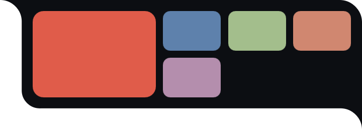
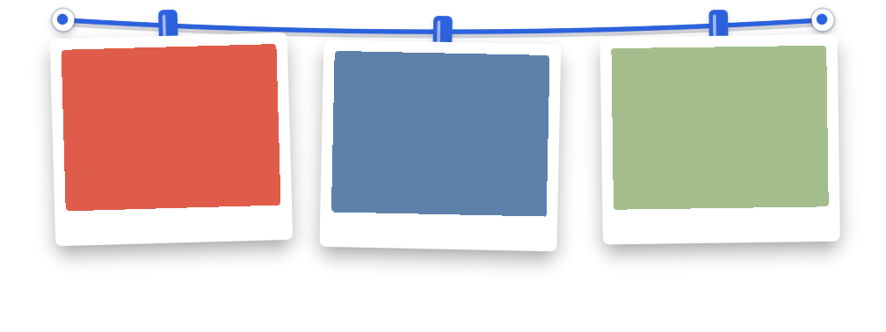

# Xitu

Xitu (Chinese: 系图) is a screenshot clothesline. On Windows every screenshot hangs on a rope along the top edge of each screen. The Linux port runs on Hyprland + Quickshell and shows a drawer in the top-right corner by default, switchable to the top-edge rope. Ported from `alejandrobujan/tendedero` (MIT, see `NOTICE`); the program name and icon are not covered by that license, and this program is not called Tendedero.

## What it is

Xitu hangs your screenshots on a line, like photos on a clothesline. New screenshots from your screenshot folder or clipboard hang up on their own and can be copied, opened, or taken down from the line itself.

The demo images below were rendered by the program with placeholder images (no real screenshots):






| Path | Contents |
|---|---|
| `windows/` | Windows source (`Clothesline.csproj`, WPF; `Assets/`, `Capture/`, `tools/make-icon/`) |
| `linux/` | Linux source (Quickshell shell: QML, `xitu_helper.py`, theme JSON) |
| `docs/` | demo images |
| `LICENSE`, `NOTICE` | licensing |

## Features

Both platforms:

- Screenshots that appear in your screenshot folder or clipboard hang up on their own.
- Single click copies a photo, double click opens it. Hover and click the X to take it down; the file stays in the gallery.
- A taken-down photo falls off; in rope mode photos sway gently and every so often a breeze passes.
- A gallery window keeps everything that has been hung up.

Windows:

- Tray menu, one rope per screen, slides out from the top edge.
- Global hotkey Ctrl+Shift+A by default: box-select, click a window, or press Enter for the whole screen; the photo flies onto the rope.
- Press and hold to edit in Paint. Dragging a photo off the line only copies it; the photo stays on the rope.

Linux (Hyprland + Quickshell):

- Two UI modes: `drawer` (top-right drawer, default) and `rope` (top edge). The environment variable `XITU_UI=drawer|rope` takes priority over the `ui` field in `settings.json`.
- No tray menu; expand, gallery and quit are triggered with `qs ipc` (see below) or from your bar or key bindings.
- Drag cards to reorder. Rope and card colors (themes) can be switched over IPC without restarting.

## Windows build and install

Requires the .NET 8 SDK.

```
dotnet build windows/
```

Building on a non-Windows machine needs `-p:EnableWindowsTargeting=true`:

```
dotnet build windows/ -p:EnableWindowsTargeting=true
```

Publish example (single file, uses the installed .NET runtime):

```
dotnet publish windows/ -c Release -r win-x64 --self-contained false -p:PublishSingleFile=true -o publish
```

Regenerate the icon:

```
dotnet run --project windows/tools/make-icon -- windows/Assets
```

Runtime files (source: `windows/AppPaths.cs`):

- Log: `%LOCALAPPDATA%\Xitu\log.txt`
- Rope state: `%LOCALAPPDATA%\Xitu\state.json`
- Hotkey and gallery settings: `%LOCALAPPDATA%\Xitu\settings.json`
- Clipboard staging: `%LOCALAPPDATA%\Xitu\Inbox\`
- Gallery: `%USERPROFILE%\Pictures\系图\` (default; changeable in settings)

## Linux dependencies and running

Dependencies — only what the code actually calls:

- Quickshell (`qs`): shell runtime. The repository does not pin a version.
- Hyprland: per-screen windows and focus tracking go through Quickshell's Hyprland integration.
- Python 3 with Pillow: file and clipboard helper (`linux/xitu_helper.py`).
- wl-clipboard: `wl-paste` (clipboard watch) and `wl-copy` (single-click copy).
- inotify-tools: `inotifywait` (screenshot folder watch).
- xdg-utils and gio: `xdg-open`, `xdg-user-dir PICTURES`, and `gio trash` (gallery deletion goes to the trash).

The Linux version does not capture screenshots itself; it picks them up from the screenshot folder and the clipboard.

Run from the repository root:

```
qs -p linux
```

Keyboard shortcuts and menu entries talk over IPC:

```
qs ipc -p linux call xitu toggle
```

Functions on IPC target `xitu`: `toggle`, `peek`, `hang <path>`, `openLibrary`, `gallery`, `closeGallery`, `quit`, `setTheme <id>`, `themes`, `nextTheme`.

## Caelestia integration (optional)

Xitu runs on its own with `qs -p linux`; Caelestia is not required.

- Drawer colors: in `drawer` mode the drawer reads Caelestia's color scheme live from `${XDG_STATE_HOME:-~/.local/state}/caelestia/scheme.json`. Without that file it uses a built-in dark scheme. (`linux/ThemeEngine.qml`)
- Rope theme: `linux/themes/caelestia.json` is a rope theme in Caelestia's palette; switch to it with `qs ipc -p linux call xitu setTheme caelestia`.
- Embedding: the background logic lives in `linux/XituCore.qml`, separate from the windows, so another Quickshell shell (for example a Caelestia config) can host the drawer itself. In that setup only `rope` mode still needs this process.

Optional accent for rope themes whose color is `accent`: point two environment variables at files provided by your desktop shell. If either is unset or unreadable, the theme's own accent is used (default `#3D6FE0`).

- `XITU_ACCENT_QML` — a QML file containing an `activeWorkspaceBackground` color
- `XITU_ACCENT_STATE` — an env file containing a `theme=light|dark` line

## Config and data files

Windows paths are listed under "Windows build and install". Linux paths, with the source file that defines each:

| Path | Purpose | Defined in |
|---|---|---|
| `${XDG_DATA_HOME:-~/.local/share}/Xitu/state.json` | what is on the rope (same format as Windows) | `linux/xitu_helper.py` |
| `${XDG_DATA_HOME:-~/.local/share}/Xitu/settings.json` | settings (`ui`, `Theme`, `LibraryPath`, …) | `linux/xitu_helper.py`; `linux/shell.qml` reads the `ui` field from the same file |
| `${XDG_DATA_HOME:-~/.local/share}/Xitu/log.txt` | helper log | `linux/xitu_helper.py` |
| `${XDG_DATA_HOME:-~/.local/share}/Xitu/themes/<id>.json` | custom themes (same id overrides the built-in) | `linux/themes/README.md` |
| gallery root | `系图/` under `xdg-user-dir PICTURES` (falls back to `~/Pictures`), overridable via `LibraryPath` | `linux/xitu_helper.py` |
| screenshot folder | watched for new screenshots: `$XITU_SCREENSHOT_DIR` if set, otherwise `Screenshots/` (or an existing `屏幕截图/`) under the Pictures folder | `linux/xitu_helper.py` (`screenshot-dir`) |

## Acknowledgments and license

- Xitu is a port of `alejandrobujan/tendedero` by Alejandro Buján, MIT licensed; its license is reproduced in `NOTICE`.
- This repository is MIT licensed (`LICENSE`, copyright line `Copyright (c) 2026 quin-nqin46`); see also `NOTICE`.
- The name Xitu and the icon are not part of the original license, and this program is not called Tendedero.
