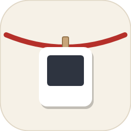

<p align="center">
  
</p>

<h1 align="center">系图 Xitu</h1>

<p align="center">
  给截图一根晾衣绳：新截的图挂在屏幕顶上，<br>
  随手复制、打开，或者直接拖进聊天框。
</p>

<p align="center">
  <a href="LICENSE"></a>
  
  
</p>

<p align="center"><a href="README.md">English</a> · <b>简体中文</b></p>

<p align="center">
  
</p>

## 是什么

截图平时一截就沉进文件夹。系图把最近的几张留在眼前：截图文件夹或剪贴板里来了新图，它就落到屏幕顶边的一根绳子上，轻轻晃一晃，一直挂着，直到你把它取下。单击复制，双击打开，也能直接把照片拖进聊天窗口。

Windows 版是托盘程序，每块屏幕一根绳。Linux 版跑在 Hyprland + Quickshell 上，同样是顶边的一根绳子。


系图最初移植自 macOS 上的 [Tendedero](https://github.com/alejandrobujan/tendedero)（MIT，见 `NOTICE`），有自己的名字和图标，不是 Tendedero。

| 路径 | 内容 |
|---|---|
| `windows/` | Windows 源码（`Clothesline.csproj`，WPF；`Assets/`、`Capture/`、`tools/make-icon/`） |
| `linux/` | Linux 源码（Quickshell 壳：QML、`xitu_helper.py`） |
| `shared/themes/` | 绳子主题（JSON），Windows 和 Linux 都读这一份 |
| `shared/tests/` | 测试用例（JSON），Windows 的 xunit 和 Linux 的 pytest 都跑 |
| `docs/` | 演示图 |
| `LICENSE`、`NOTICE` | 许可与致谢 |

## 安装

### Windows

1. 到 [Releases](https://github.com/quin-nqin46/xitu/releases/latest) 下载 `Xitu-<版本>-win-x64.zip`，解压到一个固定的位置（比如 `D:\Apps\Xitu\`）。
2. 双击 `Xitu.exe`。程序自带 .NET 运行时，不用另装。
3. 第一次运行时 Windows SmartScreen 可能提示「Windows 已保护你的电脑」（程序没有代码签名）：点「更多信息」→「仍要运行」。
4. 系图在右下角托盘运行。要开机自启：右键托盘图标 › 开机自启。

截图按 Ctrl+Shift+A。这个键被微信、QQ 等占用时会弹提示，到 设置 › 快捷键 里换一个。

### Linux（Hyprland）

1. 到 [Releases](https://github.com/quin-nqin46/xitu/releases/latest) 下载 `xitu-<版本>-linux.tar.gz` 并解压，或者 `git clone` 本仓库。
2. 在解压出来的目录（或仓库根目录）里运行：

   ```
   sh linux/install.sh
   ```

   脚本会检查依赖，缺什么就按你的发行版打印安装命令（不会自己用 sudo 装）；把程序装到 `~/.local/share/Xitu/app`，命令装到 `~/.local/bin/xitu`；写一份 `~/.config/hypr/xitu.conf`（登录时自启，Ctrl+Shift+A 截图），并问要不要在 `hyprland.conf` 末尾加一行 `source` 它。在 Hyprland 里运行时，装完直接启动。
3. 缺的包装好以后，运行 `xitu start`（或重新登录）。

需要的包：quickshell、python3 和 Pillow、wl-clipboard、inotify-tools、xdg-utils、gio（glib2）。可选：grim 和 slurp（自带截图）、xdg-user-dirs、libnotify（缺东西时弹通知）、zenity 或 kdialog（另存为、选文件夹）、satty 或 swappy（编辑）。`sh linux/install.sh --check` 只检查、不安装。系图运行时如果发现缺了必需的包，会弹一条通知。

常用命令：`xitu`（放下或收起绳子）、`xitu capture`、`xitu gallery`、`xitu settings`、`xitu quit`。卸载：`sh linux/install.sh --uninstall`，图库和设置会留着。

如果 `hyprland.conf` 里已经有别的程序绑了 Ctrl+Shift+A，两个都会触发；改 `~/.config/hypr/xitu.conf` 里的 `bind` 那行即可。目前只完整支持 Hyprland；GNOME 和 X11 不支持。

## 功能

两边共有：

- 截图文件夹和剪贴板里出现的截图自动挂上。浏览器里「复制图片」也会挂上。和表格、文字、文件一起复制的位图不挂。
- 自动挂哪些由 `settings.json` 的 `Collect` 决定（两边都在 设置 › 自动挂上；Linux 从图库左下角「设置…」、绳子空白处右键菜单，或 `qs ipc … call xitu settings` 打开设置）：`all`（默认，截图和复制的图片）、`screenshots`（只要截图，复制的图片不挂）、`own`（只要系图自己截的图，截图文件夹和剪贴板都不看）。拖进来的图总会挂上。
- 单击复制，双击打开；悬停点叉取下，文件留在图库。
- 取下时照片落下；绳子模式里照片轻摆，偶尔有微风。
- 图库窗口保存挂过的所有照片。

Windows：

- 托盘菜单，每屏一条绳，从顶边滑出。
- 默认全局热键 Ctrl+Shift+A：框选、点窗口或按 Enter 整屏，照片飞上绳。
- 绳子主题：托盘菜单 › 换主题。和 Linux 用同一份主题文件（`shared/themes/`），默认是蓝绳 + 拍立得，原来的红绳留作「红绳」主题。自己的主题放 `%LOCALAPPDATA%\Xitu\themes\<id>.json`。
- 长按用画图编辑。把照片拖出绳子只复制，照片留在绳上。

Linux（Hyprland + Quickshell）：

- 设置窗口和 Windows 版对齐：图库位置（可选把图搬过去）、保存时间和「立即清理过期」、自动挂上、主题。选文件夹用 `zenity` 或 `kdialog`，都没装就直接在框里输入路径。
- 没有托盘菜单；展开、图库、退出用 `qs ipc`（见下）或由顶栏、按键绑定触发。
- 长按卡片（或右键 › 编辑）打开编辑器：设了 `XITU_EDITOR` 就用它（路径接在最后，或写 `{}` 占位），否则 satty、swappy（存回原图），都没有就用 `xdg-open`。存盘后卡片自动刷新（需要 `inotifywait`）。
- 拖动卡片换位置。绳子和卡片的颜色（主题）可通过 IPC 切换，不用重启。
- 从浏览器或文件管理器把图片拖到屏幕顶边的中间，绳子会放下来把它收进来。
- 两边一样：卡片右键 › 另存为… 把图另存一份到别处，图库里的原图不动。Linux 的保存对话框需要 `zenity` 或 `kdialog`。
- 两边一样：指针停在屏幕顶边的中间那一段（挂照片的那一段，至少 320 像素宽）0.3 秒，绳子才放下来。两角和顶边的其他地方（标签页、标题栏、工作区按钮）碰了不再触发。

## Windows 从源码构建

需要 .NET 8 SDK。

```
dotnet build windows/
```

在非 Windows 机器上编译要加 `-p:EnableWindowsTargeting=true`：

```
dotnet build windows/ -p:EnableWindowsTargeting=true
```

发布（单文件，自带 .NET 运行时，和 Releases 里的一样）：

```
dotnet publish windows/ -c Release -r win-x64 --self-contained true -p:PublishSingleFile=true -p:IncludeNativeLibrariesForSelfExtract=true -p:EnableCompressionInSingleFile=true -o publish
```

发新版本：推一个 `v*` 标签（`git tag v0.2.0 && git push origin v0.2.0`），`.github/workflows/release.yml` 会打好 Windows zip 和 Linux tar.gz、做冒烟测试，然后发 GitHub Release。

重新生成图标：

```
dotnet run --project windows/tools/make-icon -- windows/Assets
```

运行时文件（出处：`windows/AppPaths.cs`）：

- 日志：`%LOCALAPPDATA%\Xitu\log.txt`
- 绳上条目：`%LOCALAPPDATA%\Xitu\state.json`
- 快捷键与图库设置：`%LOCALAPPDATA%\Xitu\settings.json`
- 剪贴板暂存：`%LOCALAPPDATA%\Xitu\Inbox\`
- 图库：`%USERPROFILE%\Pictures\系图\`（默认；设置里可改）

## Linux 从源码运行

依赖（只列代码里实际调用的）：

- Quickshell（`qs`）：壳的运行时。仓库未钉版本。
- Hyprland：每屏窗口与聚焦屏判断走 Quickshell 的 Hyprland 集成。
- Python 3 + Pillow：文件与剪贴板助手（`linux/xitu_helper.py`）。
- wl-clipboard：`wl-paste`（剪贴板监听）和 `wl-copy`（单击复制）。
- inotify-tools：`inotifywait`（截图文件夹监听）。
- xdg-utils 和 gio：`xdg-open`、`xdg-user-dir PICTURES`、`gio trash`（图库删除进回收站）。

下面是不用安装脚本、直接从仓库运行的方法（开发用）。

助手脚本的测试（需要 pytest 和 Pillow，`shared/tests` 里 layout.js 的用例还要 node；不需要 Wayland 和桌面环境）：

```
python3 -m pytest linux/tests
```

在仓库根目录运行：

```
qs -p linux
```

按键和菜单入口走 IPC：

```
qs ipc -p linux call xitu toggle
```

自带截图，对应 Windows 的 Ctrl+Shift+A（需要 `grim` 和 `slurp`；拖一块、点一个窗口，或点一块屏幕）。在 Hyprland 里绑键：

```
bind = CTRL SHIFT, A, exec, qs ipc -p /path/to/xitu/linux call xitu capture
```

截到的图从框选处飞上绳子（同 Windows），进图库，`CopyToClipboard` 没设成 `false` 时也会复制。没装 grim / slurp 时会弹通知，请改用系统截图键（存进截图文件夹的图照样会挂上）。

IPC target `xitu` 上的函数：`toggle`、`peek`、`clear`、`hang <路径>`、`openLibrary`、`gallery`、`closeGallery`、`settings`、`capture`、`quit`、`setTheme <id>`、`themes`、`nextTheme`。

## 可选：与 Caelestia 整合

系图用 `qs -p linux` 就能独立运行，不依赖 Caelestia。

- 绳子主题：`shared/themes/caelestia.json` 是按 Caelestia 配色做的一套绳子主题，用 `qs ipc -p linux call xitu setTheme caelestia` 切换。
- 嵌入：后台逻辑单独放在 `linux/XituCore.qml`，与窗口分开，别的 Quickshell 外壳可以自己承载。

绳子主题里颜色写成 `accent` 的部分，可以跟随桌面外壳的强调色：用两个环境变量指向外壳提供的文件。任一个没设或读不到，就用主题自带的强调色（默认 `#3D6FE0`）。

- `XITU_ACCENT_QML`：含 `activeWorkspaceBackground` 颜色的 QML 文件
- `XITU_ACCENT_STATE`：含 `theme=light|dark` 一行的 env 文件

## 配置与数据文件

Windows 路径见上文「Windows 从源码构建」。Linux 路径，每条注明定义它的源文件：

| 路径 | 用途 | 出处 |
|---|---|---|
| `${XDG_DATA_HOME:-~/.local/share}/Xitu/state.json` | 绳上条目（与 Windows 版同格式） | `linux/xitu_helper.py` |
| `${XDG_DATA_HOME:-~/.local/share}/Xitu/settings.json` | 设置（`Theme`、`LibraryPath`、`RetentionDays`、`Collect` 等） | `linux/xitu_helper.py` |
| `${XDG_DATA_HOME:-~/.local/share}/Xitu/log.txt` | 助手日志 | `linux/xitu_helper.py` |
| `${XDG_DATA_HOME:-~/.local/share}/Xitu/themes/<id>.json` | 自定义主题（id 相同则覆盖内置） | `shared/themes/README.md` |
| 图库根目录 | `xdg-user-dir PICTURES`（取不到时用 `~/Pictures`）下的 `系图/`，可用 `LibraryPath` 改 | `linux/xitu_helper.py` |
| 截图文件夹 | 监听新截图：设了 `$XITU_SCREENSHOT_DIR` 就只盯它；否则 `XDG_SCREENSHOTS_DIR`；都没有时盯「图片」下已有的 `Screenshots/`、`屏幕截图/`，再加「图片」根目录（grim、grimblast、hyprshot 默认存这里，根目录里只收文件名像截图的）。只盯已经存在的文件夹，不会替你新建 | `linux/xitu_helper.py`（`screenshot-dirs`） |

## 致谢与许可

- 系图从 Alejandro Buján 的 tendedero（MIT）移植，原仓库 `alejandrobujan/tendedero`，许可证全文附在 `NOTICE` 末尾。
- 本仓库按 MIT 许可发布（`LICENSE`，版权行 `Copyright (c) 2026 quin-nqin46`），另见 `NOTICE`。
- 「系图」这个名字和图标不在原许可证范围内，本程序不叫 Tendedero。
